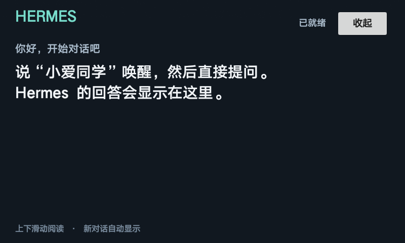

# 小爱触屏音箱 LX04 × Hermes

把初代小爱触屏音箱接入本机 Hermes：直接提问、语音回答、屏幕显示，以及每 7 天轮换一次对话。

**已在一台 LX04 / 原版 2.42.118 / Android 8.1 上验证。** Mac 负责运行 Hermes 与桥接程序；音箱保留小爱启动器与语音功能，安装约 12 KiB 的原生屏显 App。



## 能做什么

- 唤醒小爱后，所有非空问题都交给 Hermes，无需“请”或“帮我”前缀。
- 屏幕显示问题、思考状态和回答；保留换行和标点，支持长文滚动、收起和下一轮自动显示。
- 同一个 Hermes 对话连续使用 7×24 小时，重启继续沿用；到期后的首次提问才新建，旧记录保留。
- Mac 登录后启动桥接，音箱启动后启动屏显服务，显示传输失败不阻塞语音。
- 提供原版固件的离线分析、最小修改、写入读回及回退事务源码，不分发原厂固件或设备身份备份。

## 工作方式

```text
小爱识别语音 → 小米云会话记录 → Mac / XiaoGPT → 本机 Hermes Agent
                                              ├─ 小爱原生 TTS
                                              └─ 认证 ADB → Hermes 屏显 App
```

仍依赖小米云端识别，Mac 与 Hermes 需要在线。小米自身可能先回答或执行指令；这不是离线语音或实时全双工方案。
Hermes API 密钥只在 Mac 的 `~/.hermes/.env`，屏显 App 没有网络权限，只接收经过 ADB 认证传入的文字。

## 安装语音桥接

已实测环境为 macOS / Apple Silicon、Python 3.12。需要已运行的 Hermes Agent API，默认地址 `http://127.0.0.1:8642/v1`、模型 `hermes-agent`，且 `~/.hermes/.env` 包含 `API_SERVER_KEY`。

```sh
git clone https://github.com/getgithubx/xiaoai-hermes.git
cd xiaoai-hermes
# 预先安装 git 和 uv：https://docs.astral.sh/uv/getting-started/installation/
python3 tools/setup.py
```

安装器获取固定版本 XiaoGPT、应用全量转发补丁并创建独立虚拟环境，不修改现有 Hermes。编辑 `config.yaml` 可调整 API 地址、模型与语音提示词。

先完成下面的屏显配置；如果只使用语音，可保留示例配置，屏显连接失败会自动重试而不阻塞语音。

```sh
./.venv/bin/python bridge.py
```

首次输入绑定 LX04 的小米账号和密码，按提示完成验证码。密码不保存；令牌保存到私有 `state/`。重新登录使用 `./.venv/bin/python bridge.py --login`。也可在 macOS 双击 `connect.command`（如下载方式未保留权限，先 `chmod +x *.command`）。

## 安装屏显 App

前提是**正常系统 ADB 已开启并授权这台 Mac**。原版固件没有开发者选项时，先阅读 [ADB 固件研究](docs/FIRMWARE.md)；仅连接 MTP 或进入 Recovery 不满足条件。

1. 下载官方 Android 工具：`python3 tools/setup_android.py`（此辅助脚本支持 macOS）。
2. 安装 JDK 21，例如 `brew install openjdk@21`，设置 `JAVA_HOME` 为该 JDK 的安装目录。
3. 运行 `./tools/platform-tools/adb devices -l`，查看音箱 USB 序列号。也可用 `adb connect 音箱IP:5555` 连接已开放的认证网络 ADB。
4. 编辑 `screen-config.json`，填写音箱实际 IP 和 USB 序列号。该文件从 `screen-config.example.json` 复制生成，不提交到 Git。
5. 构建和安装：

```sh
./.venv/bin/python screen-app/build.py
./.venv/bin/python tools/install_screen.py
```

构建结果在 `screen-app/build/hermes-screen.apk`，生成的签名材料仅保存在私有 `state/`。升级同一应用请保留签名密钥。如果使用 Releases 中预编译的 APK，可把它放到上述路径后执行安装脚本；切换为不同签名的自行构建版本需要先卸载旧版。

使用时说“小爱同学”后直接提问，屏幕会显示问答；上下滑动阅读，右上角“收起”返回小爱。运行 `open-screen.command` 可再次打开最近回答。新消息自动显示；音箱开机先后台等待消息。屏幕最多显示 12000 字并标明截断。

网络 ADB 地址改变时更新 `screen-config.json` 并重启桥接。程序会优先使用已连接的网络 ADB，再尝试已连接 USB，否则重连配置中的网络地址。

## 自动启动

完成首次登录后，先停止前台桥接，再运行：

```sh
./.venv/bin/python tools/install_launchagent.py
./start-background.command
```

安装器生成当前用户的 `~/Library/LaunchAgents/local.xiaoai-hermes.plist`，使用当前仓库的绝对路径；若已有服务则拒绝覆盖。Mac 登录后自动运行，异常退出后由 launchd 拉起。关闭终端不影响后台服务。

`stop-background.command` 停止当前后台服务；`start-background.command` 再次启动。日志为私有 `state/background.log`。修改代码后可执行 `launchctl kickstart -k gui/$(id -u)/local.xiaoai-hermes`。

## 7 天会话规则

`X-Hermes-Session-Key` 固定音箱的记忆通道，`X-Hermes-Session-Id` 明确继续同一对话，历史由 Hermes 数据库加载。

会话 ID 与开始时间原子保存到 `state/hermes-session.json`。首次接续该通道最新已有会话；从其开始时间计满 604800 秒后，在下一条消息到达时创建新 ID。重启不重置，空闲不会创建空会话，旧会话不会删除。Hermes 自身的上下文压缩可能生成内部续接子会话，API 会沿原 ID 找到当前续接位置。

## 验证范围

已验证正常开机后的 USB / 局域网 root ADB、屏显安装、中文与长文滚动、收起后再显示、普通重启后的屏显服务自动启动、真实 Hermes 回复到屏幕，以及两个新建客户端继续同一会话并记住上文。

```sh
./.venv/bin/python -m unittest discover -s tools -p 'test_*.py'
```

共 11 项测试覆盖 7 天边界、重启持久化、会话隔离、屏显原文保留/断线处理与刷写事务故障回退。它们不访问音箱、不刷写固件。

真实语音问题曾进入 Hermes；本次屏显验收没有重新完整测试麦克风输入到实际音频播报。其他硬件批次、固件版本与非 macOS 环境未验证。

## 项目内容

| 路径 | 用途 |
|---|---|
| `bridge.py` / `all-queries.patch` | 小米会话 → Hermes → TTS/屏显 |
| `screen_display.py` / `hermes_session.py` | 后台 ADB 显示、7 天对话续接 |
| `screen-app/` | 无第三方运行依赖的原生 Android App |
| `tools/setup*.py` | 固定上游依赖与官方 Android 工具安装 |
| `tools/*adb_firmware.py` | 原版 2.42.118 固件修改及受限写入研究源码 |
| `docs/FIRMWARE.md` | REA/Ghidra 逆向结论、验证边界与回退要求 |
| `NOTICE.md` | 第三方出处、许可证与未包含的内容 |

账号令牌、私钥、原机备份、固件镜像、设备身份、个人对话和 SDK 二进制不在本仓库中。
